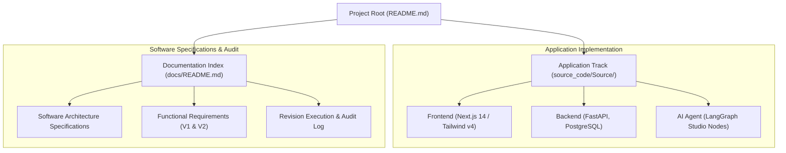

# SciStudio v2.0 & Multi-Domain Agentic RAG Platform Documentation

This directory contains software modernization specifications, functional requirements, and engineering roadmaps for the **Academic Research Studio (SciStudio v2.0)**.

---

## 📑 Documentation Index

### Software Architecture & Upgrade Specifications (`software_upgrade_plan/`)
Engineering specifications outlining the complete architecture, database, API contracts, and implementation:

| Document | Area / Specification |
| :--- | :--- |
| **[`00_OVERVIEW_AND_VISION.md`](software_upgrade_plan/00_OVERVIEW_AND_VISION.md)** | Architectural vision, functional requirements, and non-functional goals. |
| **[`01_DATABASE_ARCHITECTURE.md`](software_upgrade_plan/01_DATABASE_ARCHITECTURE.md)** | PostgreSQL relational schema, session persistence, and indexing strategy. |
| **[`02_BACKEND_AND_RETRIEVAL.md`](software_upgrade_plan/02_BACKEND_AND_RETRIEVAL.md)** | FastAPI gateway design, LangGraph state engine, and hybrid retrieval. |
| **[`03_FRONTEND_AND_UX.md`](software_upgrade_plan/03_FRONTEND_AND_UX.md)** | Next.js 14 design system, Tailwind styling, and live telemetry rendering. |
| **[`04_API_AND_WEBSOCKET_SPECS.md`](software_upgrade_plan/04_API_AND_WEBSOCKET_SPECS.md)** | Contract specifications for REST endpoints and bidirectional WebSocket streaming. |
| **[`05_IMPLEMENTATION_ROADMAP.md`](software_upgrade_plan/05_IMPLEMENTATION_ROADMAP.md)** | Phase-by-phase development timeline and milestone criteria. |
| **[`06_FUNCTIONAL_REQUIREMENTS_V1_V2.md`](software_upgrade_plan/06_FUNCTIONAL_REQUIREMENTS_V1_V2.md)** | Comprehensive Functional Requirements Specification (FRS) covering both Version 1.0 (Interactive Chatbot) and Version 2.0 (Academic Studio IDE) with Evolution & RTM matrices. |
| **[`PHASE_EXECUTION_AND_AUDIT_LOG.md`](software_upgrade_plan/PHASE_EXECUTION_AND_AUDIT_LOG.md)** | Initial 5-Phase implementation and commit audit tracker. |
| **[`REVISION_EXECUTION_AND_AUDIT_LOG.md`](REVISION_EXECUTION_AND_AUDIT_LOG.md)** | Master revision and audit log for peer review feedback and publication readiness. |

---

## 🗺 Documentation Map

