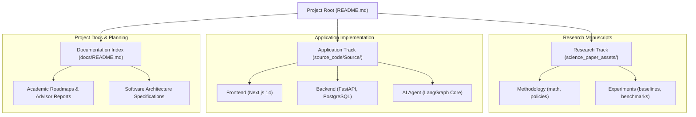

# Project Documentation & Engineering Roadmaps

This directory contains strategic action plans, software modernization specifications, and formal academic reports for the **Multi-Domain Agentic RAG Platform**.

---

## 📑 Documentation Index

### 1. Academic Roadmap & Advisor Reports (`paper_roadmap/`)
Strategic planning and response reports addressing feedback from the faculty advisor (GVHD):

| Document | Purpose & Summary |
| :--- | :--- |
| **[`BAO_CAO_GIAI_TRINH_VA_HOAN_THIEN_2_BAI_BAO.md`](paper_roadmap/BAO_CAO_GIAI_TRINH_VA_HOAN_THIEN_2_BAI_BAO.md)** | **Báo cáo giải trình chính thức gửi GVHD:** Tổng hợp chi tiết việc vẽ lại 5 sơ đồ kỹ thuật, bảng đối chứng 5 SOTA baselines ($p < 0.001$), hoàn thiện Bài 1 (Research Paper) và Bài 2 (System Demo Paper). |
| **[`ACTION_PLAN_DUAL_PAPERS.md`](paper_roadmap/ACTION_PLAN_DUAL_PAPERS.md)** | Kế hoạch hành động 2 bài báo song song (Track 1: Research Paper & Track 2: Open-Source System Paper). |
| **[`ACTION_PLAN_RESULTS.md`](paper_roadmap/ACTION_PLAN_RESULTS.md)** | Nhật ký đối chiếu tiến độ hoàn thành các hạng mục P0/P1/P2 trong kế hoạch hành động. |
| **[`technical_upgrade_report.md`](paper_roadmap/technical_upgrade_report.md)** | Báo cáo chi tiết quá trình nâng cấp kỹ thuật từ prototype CLI lên hệ thống Fullstack Web. |

---

### 2. Software Architecture & Upgrade Specifications (`software_upgrade_plan/`)
Engineering specifications outlining the transition to enterprise-grade fullstack architecture:

| Document | Area / Specification |
| :--- | :--- |
| **[`00_OVERVIEW_AND_VISION.md`](software_upgrade_plan/00_OVERVIEW_AND_VISION.md)** | Architectural vision, functional requirements, and non-functional goals. |
| **[`01_DATABASE_ARCHITECTURE.md`](software_upgrade_plan/01_DATABASE_ARCHITECTURE.md)** | PostgreSQL relational schema, session persistence, and indexing strategy. |
| **[`02_BACKEND_AND_RETRIEVAL.md`](software_upgrade_plan/02_BACKEND_AND_RETRIEVAL.md)** | FastAPI gateway design, LangGraph state engine, and hybrid retrieval. |
| **[`03_FRONTEND_AND_UX.md`](software_upgrade_plan/03_FRONTEND_AND_UX.md)** | Next.js 14 design system, Tailwind styling, and live telemetry rendering. |
| **[`04_API_AND_WEBSOCKET_SPECS.md`](software_upgrade_plan/04_API_AND_WEBSOCKET_SPECS.md)** | Contract specifications for REST endpoints and bidirectional WebSocket streaming. |
| **[`05_IMPLEMENTATION_ROADMAP.md`](software_upgrade_plan/05_IMPLEMENTATION_ROADMAP.md)** | Phase-by-phase development timeline and milestone criteria. |

---

## 🗺 Documentation Map

