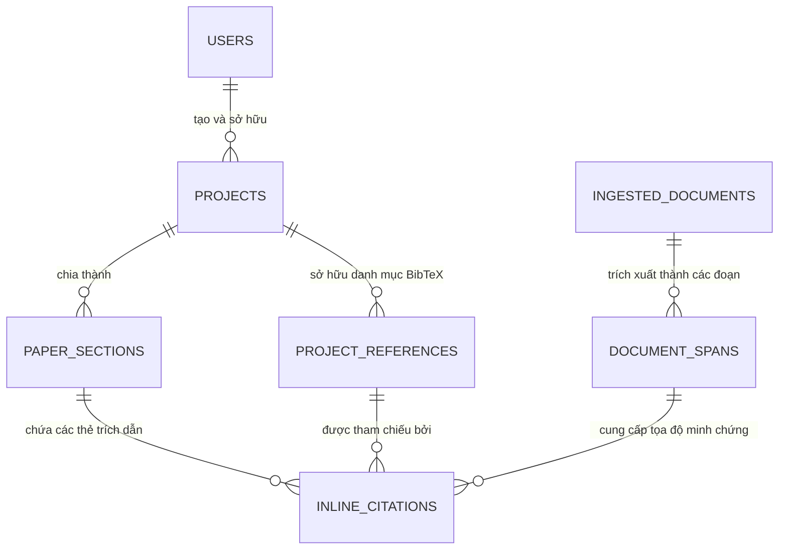

# 01. THIẾT KẾ CƠ SỞ DỮ LIỆU MỚI (DATABASE ARCHITECTURE)
## Chuyển đổi Mô hình Dữ liệu từ "Chat Logging" sang "Academic Project Entity Model"

---

### 1. TỔNG QUAN KIẾN TRÚC DỮ LIỆU

Hệ thống cơ sở dữ liệu chuyển từ PostgreSQL lưu trữ tin nhắn hội thoại (`users`, `chat_sessions`, `messages`) sang mô hình quan hệ quản lý cấu trúc bài báo khoa học chuẩn mực. Mô hình mới đảm bảo:
* Quản lý phân cấp dự án: Người dùng $\rightarrow$ Bài báo $\rightarrow$ Chương mục (Sections) $\rightarrow$ Trích dẫn (Citations).
* Lưu trữ và đồng bộ danh mục trích dẫn chuẩn BibTeX (`@article`, `@inproceedings`,...).
* Quản lý tọa độ hình học (Bounding Boxes) của các đoạn văn trong 618 bài báo PDF để phục vụ tính năng **Click-to-Verify**.

---

### 2. SƠ ĐỒ THỰC THỂ QUAN HỆ (ENTITY RELATIONSHIP DIAGRAM)



---

### 3. ĐẶC TẢ DDL SQL CHI TIẾT (POSTGRESQL SCHEMAS)

#### 3.1. Bảng `projects` (Dự án Bài báo Khoa học)
Quản lý thông tin chung của bài báo đang soạn thảo:
```sql
CREATE TABLE projects (
    id UUID PRIMARY KEY DEFAULT gen_random_uuid(),
    user_id UUID NOT NULL REFERENCES users(id) ON DELETE CASCADE,
    title VARCHAR(500) NOT NULL,
    template_type VARCHAR(50) DEFAULT 'ieee_conference', -- 'ieee_conference', 'springer_lncs', 'acm', 'thesis'
    target_venue VARCHAR(255),                            -- Tên hội thảo hoặc tạp chí mục tiêu
    primary_domain VARCHAR(50) DEFAULT 'it',              -- it, math, physics, electronics, medicine, agriculture, law, economics
    abstract_text TEXT DEFAULT '',
    keywords VARCHAR(255)[] DEFAULT ARRAY[]::VARCHAR[],
    created_at TIMESTAMP WITH TIME ZONE DEFAULT NOW(),
    updated_at TIMESTAMP WITH TIME ZONE DEFAULT NOW()
);

CREATE INDEX idx_projects_user_id ON projects(user_id);
```

#### 3.2. Bảng `paper_sections` (Chương mục Bản thảo)
Lưu trữ nội dung của từng phần bài viết (hỗ trợ lưu cả định dạng Rich-text Markdown và LaTeX biên dịch):
```sql
CREATE TABLE paper_sections (
    id UUID PRIMARY KEY DEFAULT gen_random_uuid(),
    project_id UUID NOT NULL REFERENCES projects(id) ON DELETE CASCADE,
    title VARCHAR(255) NOT NULL,                         -- '1. Introduction', '2. Related Work', '3. Methodology'
    slug VARCHAR(100) NOT NULL,                          -- 'introduction', 'methodology'
    order_index INT NOT NULL,                            -- Thứ tự hiển thị trong cây thư mục
    content_markdown TEXT DEFAULT '',                    -- Lưu định dạng WYSIWYG Editor
    content_latex TEXT DEFAULT '',                       -- Lưu bản sinh mã LaTeX
    word_count INT DEFAULT 0,
    created_at TIMESTAMP WITH TIME ZONE DEFAULT NOW(),
    updated_at TIMESTAMP WITH TIME ZONE DEFAULT NOW()
);

CREATE INDEX idx_sections_project_order ON paper_sections(project_id, order_index);
```

#### 3.3. Bảng `project_references` (Thư viện BibTeX của Dự án)
Quản lý toàn bộ danh mục tài liệu tham khảo đính kèm trong bài:
```sql
CREATE TABLE project_references (
    id UUID PRIMARY KEY DEFAULT gen_random_uuid(),
    project_id UUID NOT NULL REFERENCES projects(id) ON DELETE CASCADE,
    bibtex_key VARCHAR(100) NOT NULL,                    -- e.g., 'lewis2020retrieval', 'chen2024bge'
    title VARCHAR(500) NOT NULL,
    authors TEXT,
    year INT,
    venue VARCHAR(255),
    doi VARCHAR(100),
    pdf_source_path VARCHAR(500),                        -- Đường dẫn tệp PDF trong data/raw/
    bibtex_raw TEXT NOT NULL,                            -- Nguyên văn khối @article{key, title={...}, ...}
    created_at TIMESTAMP WITH TIME ZONE DEFAULT NOW(),
    CONSTRAINT unique_project_bibtex_key UNIQUE (project_id, bibtex_key)
);

CREATE INDEX idx_references_project_key ON project_references(project_id, bibtex_key);
```

#### 3.4. Bảng `document_spans` (Tọa độ Đoạn văn trên Trang PDF)
Lưu trữ thông tin hình học của từng đoạn văn trong 618 bài báo gốc để vẽ Bounding Box:
```sql
CREATE TABLE document_spans (
    id UUID PRIMARY KEY DEFAULT gen_random_uuid(),
    domain VARCHAR(50) NOT NULL,                         -- it, math, physics, etc.
    document_name VARCHAR(255) NOT NULL,                 -- e.g., 'YOLOv10_realtime.pdf'
    page_number INT NOT NULL,                            -- Trang số (1-indexed)
    bbox_x0 FLOAT NOT NULL,                              -- Tọa độ hộp bao trên trang PDF (chuẩn hóa 0-1 hoặc pixel)
    bbox_y0 FLOAT NOT NULL,
    bbox_x1 FLOAT NOT NULL,
    bbox_y1 FLOAT NOT NULL,
    text_content TEXT NOT NULL,                          -- Nội dung văn bản của đoạn trích
    chunk_id VARCHAR(100)                                -- ID tương ứng trong ChromaDB collection
);

CREATE INDEX idx_spans_doc_page ON document_spans(domain, document_name, page_number);
CREATE INDEX idx_spans_chunk_id ON document_spans(chunk_id);
```

#### 3.5. Bảng `inline_citations` (Liên kết Trích dẫn và Kiểm chứng)
Kết nối giữa câu khẳng định trong bản thảo với tài liệu gốc và trạng thái kiểm chứng chống ảo giác:
```sql
CREATE TABLE inline_citations (
    id UUID PRIMARY KEY DEFAULT gen_random_uuid(),
    section_id UUID NOT NULL REFERENCES paper_sections(id) ON DELETE CASCADE,
    reference_id UUID NOT NULL REFERENCES project_references(id) ON DELETE CASCADE,
    span_id UUID REFERENCES document_spans(id) ON DELETE SET NULL,
    claim_text TEXT NOT NULL,                            -- Câu nhận định trong bài cần trích dẫn
    similarity_score FLOAT,                              -- Điểm tương quan giữa câu khẳng định và tài liệu gốc
    verification_status VARCHAR(50) DEFAULT 'unverified', -- 'verified', 'unverified', 'flagged_hallucination'
    created_at TIMESTAMP WITH TIME ZONE DEFAULT NOW()
);

CREATE INDEX idx_citations_section ON inline_citations(section_id);
```

---

### 4. CHIẾN LƯỢC MIGRATE VÀ DUY TRÌ TÍNH TƯƠNG THÍCH

1. **Bảo tồn Lịch sử Chat Cũ:**
   * Các bảng cũ (`chat_sessions`, `messages`, `users`, `profiles`) vẫn được giữ nguyên.
   * Cung cấp nút chuyển đổi: *"Convert Chat Session to Paper Project"*. Khi người dùng bấm nút này, Backend sẽ gom toàn bộ câu trả lời trong session đó thành một dự án mới trong bảng `projects`, với các câu hỏi biến thành các `paper_sections`.
2. **Cơ chế Ingestion Tọa độ (One-time Migration cho 618 PDFs):**
   * Viết script `scripts/extract_pdf_spans.py` quét toàn bộ 618 bài báo PDF trong `data/raw/` bằng `PyMuPDF` (`fitz`), trích xuất các khối văn bản kèm tọa độ hộp bao $(x_0, y_0, x_1, y_1)$ và nạp vào bảng `document_spans`.

