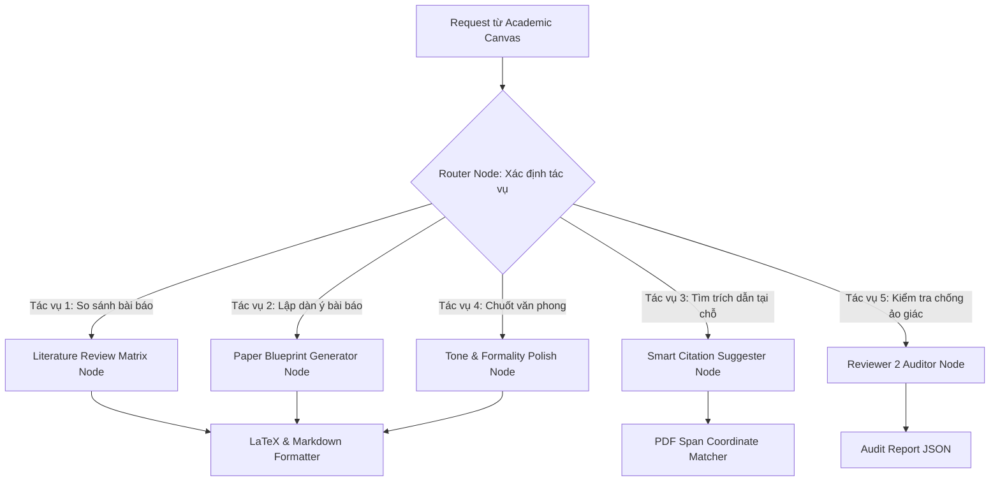

# 02. TÁI THIẾT KẾ BACKEND & PIPELINE RETRIEVAL ENGINE
## Nâng cấp Lõi Truy xuất, Khắc phục Lỗi BM25, Trích xuất Tọa độ PDF & Đồ thị LangGraph Học thuật

---

### 1. KHẮC PHỤC TRIỆT ĐỂ LỖI BM25 RETRIEVER (SQLITE VARIABLE LIMIT BUG)

#### 1.1. Hiện trạng Lỗi ghi nhận tại Log
Trong quá trình truy vấn kho tài liệu `it` có số lượng chunk lớn, hàm khởi tạo BM25 trong `local_rag.py` gọi câu lệnh `db._collection.get(...)` mà không giới hạn hoặc phân trang, dẫn đến việc SQLite (backend của ChromaDB) trả về lỗi nghiêm trọng:
```text
ERROR - Failed to create BM25 retriever: Error executing plan: 
Internal error: error returned from database: (code: 1) too many SQL variables
```
Hệ quả là hệ thống phải fallback sang Vector Search thuần túy, làm mất đi khả năng tìm kiếm từ khóa chính xác của BM25.

#### 1.2. Giải pháp Kỹ thuật Mới: Batch Loading + Disk-based Pickle Caching
1. **Phân trang (Chunk Batching):** Đọc metadata và văn bản từ ChromaDB theo các mẻ cố định ($BatchSize = 500$) để luôn giữ số lượng biến SQL nhỏ hơn giới hạn 999 của SQLite.
2. **Cơ chế Caching đĩa (Pickle Cache):** Toàn bộ corpus và đối tượng `BM25Okapi` được xây dựng một lần và lưu xuống đĩa tại `db/bm25_caches/{domain}_bm25.pkl`. Khi server khởi động hoặc xử lý request, hệ thống chỉ đọc từ file cache mất $< 0.05$ giây, thay vì quét lại toàn bộ ChromaDB trong 15–20 giây.

```python
# File: backend/retrieval/bm25_cache_manager.py
import os
import pickle
import logging
from rank_bm25 import BM25Okapi
from langchain_core.documents import Document

logger = logging.getLogger(__name__)
CACHE_DIR = "db/bm25_caches"

def get_or_create_bm25_index(domain: str, vector_store, force_rebuild: bool = False):
    os.makedirs(CACHE_DIR, exist_ok=True)
    cache_path = os.path.join(CACHE_DIR, f"{domain}_bm25.pkl")

    if not force_rebuild and os.path.exists(cache_path):
        try:
            with open(cache_path, "rb") as f:
                data = pickle.load(f)
                logger.info(f"Loaded BM25 index for '{domain}' from disk cache.")
                return data["bm25"], data["documents"]
        except Exception as e:
            logger.warning(f"Corrupt BM25 cache for '{domain}', rebuilding: {e}")

    # Safe batch extraction from ChromaDB
    logger.info(f"Building persistent BM25 index for domain: {domain}...")
    batch_size = 500
    offset = 0
    collected_docs = []

    while True:
        batch = vector_store._collection.get(
            limit=batch_size,
            offset=offset,
            include=['documents', 'metadatas']
        )
        if not batch or not batch['documents']:
            break

        for text, meta in zip(batch['documents'], batch['metadatas']):
            collected_docs.append(Document(page_content=text, metadata=meta or {}))
        
        offset += len(batch['documents'])

    if not collected_docs:
        logger.warning(f"No documents found in ChromaDB for domain '{domain}'.")
        return None, []

    # Tokenize corpus and fit BM25
    tokenized_corpus = [doc.page_content.lower().split() for doc in collected_docs]
    bm25 = BM25Okapi(tokenized_corpus)

    # Save to disk cache
    with open(cache_path, "wb") as f:
        pickle.dump({"bm25": bm25, "documents": collected_docs}, f)

    logger.info(f"Successfully cached BM25 index for '{domain}' ({len(collected_docs)} chunks).")
    return bm25, collected_docs
```

---

### 2. MODULE TRÍCH XUẤT TỌA ĐỘ BOUNDING BOX TỪ PDF (CLICK-TO-VERIFY ENGINE)

Để hỗ trợ tính năng click vào trích dẫn mở trang PDF và bôi vàng câu văn gốc, hệ thống tích hợp module trích xuất tọa độ `pdf_coordinate_extractor.py` sử dụng `PyMuPDF` (`fitz`):

```python
# File: backend/retrieval/pdf_coordinate_extractor.py
import fitz  # PyMuPDF
from typing import List, Dict

def extract_pdf_spans_with_bbox(pdf_path: str, domain: str, doc_name: str) -> List[Dict]:
    """
    Trích xuất toàn bộ text blocks cùng tọa độ hộp bao (Bounding Box) trên từng trang.
    Tọa độ trả về dưới dạng: [x0, y0, x1, y1] (pixel chuẩn hóa theo kích thước trang).
    """
    doc = fitz.open(pdf_path)
    extracted_spans = []

    for page_idx in range(len(doc)):
        page = doc[page_idx]
        page_rect = page.rect # width, height
        blocks = page.get_text("blocks") # (x0, y0, x1, y1, text, block_no, block_type)

        for b in blocks:
            text = b[4].strip()
            if len(text) < 20: # Bỏ qua header/footer/chữ quá ngắn
                continue
            
            span_data = {
                "domain": domain,
                "document_name": doc_name,
                "page_number": page_idx + 1,
                "bbox_x0": round(b[0] / page_rect.width, 4),   # Tỷ lệ chuẩn hóa (0.0 -> 1.0)
                "bbox_y0": round(b[1] / page_rect.height, 4),
                "bbox_x1": round(b[2] / page_rect.width, 4),
                "bbox_x1": round(b[3] / page_rect.height, 4),
                "text_content": text
            }
            extracted_spans.append(span_data)

    doc.close()
    return extracted_spans
```

---

### 3. CÁC STATE NODE HỌC THUẬT MỚI TRONG LANGGRAPH

Đồ thị trạng thái LangGraph được mở rộng từ các nút hỏi đáp cơ bản sang phục vụ **4 tác vụ soạn thảo chuyên sâu**:



#### Chi tiết vai trò của từng Node:
1. **`review_matrix_node` (Ma trận Tổng quan Tài liệu):**
   * Nhận vào danh sách 3–5 file PDF được người dùng chọn trong kho.
   * Truy xuất tóm tắt, phương pháp, kết quả và điểm yếu của từng bài báo.
   * Sinh ra bảng Markdown / LaTeX chuẩn định dạng `booktabs`:
     $$\begin{tabular}{lcccc} \toprule \textbf{Paper} & \textbf{Method} & \textbf{Dataset} & \textbf{Metric} & \textbf{Limitation} \\ \midrule ... \end{tabular}$$
2. **`citation_suggest_node` (Gợi ý Trích dẫn Thông minh):**
   * Khi người dùng viết một khẳng định trong Canvas (ví dụ: *"Transformer models face quadratic memory complexity..."*).
   * Node tự động truy xuất câu này trong 618 bài báo, tìm bài báo gốc (Attention Is All You Need / Longformer), trích xuất `bibtex_key` và tọa độ trang PDF gốc để người dùng chèn ngay lập tức vào bài.
3. **`academic_polish_node` (Chuốt Văn phong Khoa học):**
   * Chuyển các câu văn khẩu ngữ hoặc câu tiếng Anh thô thành văn phong học thuật chuẩn IEEE/ACM (sử dụng thể bị động phù hợp, từ vựng chuẩn xác như *demonstrates, mitigates, substantiates*).
4. **`integrity_auditor_node` (Giả lập Phản biện - Reviewer 2):**
   * Quét toàn bộ nội dung của section, đối soát từng câu với tài liệu trong cơ sở dữ liệu.
   * Báo cáo các nhận định đưa ra số liệu nhưng thiếu trích dẫn (Unbacked Claims) hoặc các câu văn sai lệch nội dung bài báo gốc.

---

### 4. MODULE BIÊN DỊCH VÀ ĐÓNG GÓI XUẤT BẢN NỘI BỘ (ZERO 3RD-PARTY)

Hệ thống cung cấp 2 cơ chế xuất bản bài báo:

1. **Biên dịch PDF 1-Click (In-app TeX Compilation):**
   * Sử dụng công cụ biên dịch dòng lệnh nhẹ **Tectonic** (hoặc `pdflatex` cài sẵn trong Docker container).
   * Backend tập hợp tất cả các file trong `paper_sections`, chèn template IEEE chuẩn (`IEEEtran.cls`), gắn file `references.bib` và thực thi:
     ```bash
     tectonic main.tex --keep-intermediates
     ```
   * Trả về file `paper.pdf` hiển thị trực tiếp trên trình duyệt chỉ mất 2–4 giây.
2. **Đóng gói Overleaf ZIP Packager:**
   * Tự động tạo cấu trúc chuẩn:
     ```text
     overleaf_package.zip
     ├── main.tex
     ├── references.bib
     ├── IEEEtran.cls
     └── figures/
         ├── fig1_architecture.png
         └── fig2_comparison.pdf
     ```
   * Người dùng tải về là có thể kéo thả trực tiếp lên Overleaf để cộng tác với đồng nghiệp.

