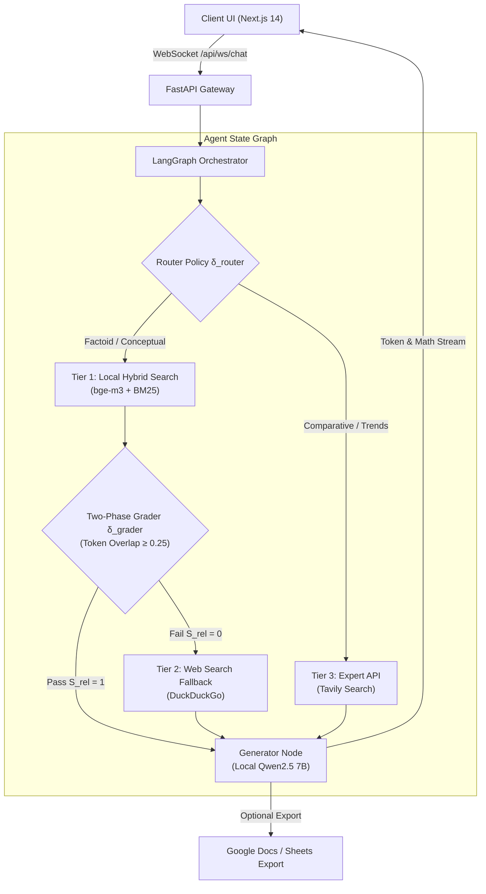

# Tiered Self-Corrective Multi-Domain Agentic RAG Platform

[](https://opensource.org/licenses/Apache-2.0)
[](https://python.org)
[](https://fastapi.tiangolo.com)
[](https://github.com/langchain-ai/langgraph)
[](https://nextjs.org)
[](https://ollama.ai)
[](https://www.docker.com/)

An end-to-end, open-source **Multi-Domain Agentic Retrieval-Augmented Generation (RAG) Platform** engineered specifically for academic and scientific inquiry. Operating under a **"Local-First, Multi-Tiered Fallback"** philosophy, the system formalizes retrieval and reasoning as a stateful directed graph $\mathcal{G} = (\mathcal{V}, \mathcal{E}, \mathcal{S})$ orchestrated via **LangGraph**, coupling intent-aware adaptive hybrid search ($bge\text{-}m3$ + BM25) with a resource-efficient Two-Phase Verification mechanism, node-by-node WebSocket chunk streaming, and 100% local inference privacy.

---

## 📑 Table of Contents
- [Key Architectural Highlights](#-key-architectural-highlights)
- [System Architecture](#-system-architecture)
- [Repository Structure](#-repository-structure)
- [Quantitative Benchmark & SOTA Baselines](#-quantitative-benchmark--sota-baselines)
- [Feature Comparison with Open-Source Platforms](#-feature-comparison-with-open-source-platforms)
- [Quick Start Guide (1-Click Docker)](#-quick-start-guide-1-click-docker)
- [Manual Development Setup](#-manual-development-setup)
- [Evaluation & Benchmarking](#-evaluation--benchmarking)
- [License](#-license)

---

## 🌟 Key Architectural Highlights

1. **Domain-Isolated Multi-Store Topology:**
   - Rather than pooling documents into a single flat collection, the knowledge base partitions **618 scientific publications into 8 isolated ChromaDB collections** (144,318 text chunks across Computer Science, Electronics, Mathematics, Physics, Agriculture, Economics, Law, Medicine).
   - Eliminates cross-disciplinary semantic collision and increases Context Precision to **0.56 (+14.3% over CRAG)**.
2. **Intent-Aware Adaptive Hybrid Retrieval:**
   - Combines multilingual dense representations ($bge\text{-}m3$, 1024-d) with sparse lexical BM25 using dynamic weighting based on query intent (Conceptual vs. Factoid).
3. **Resource-Efficient Two-Phase Verification:**
   - **Phase 1 (Fast Lexical Token Overlap Filter):** Rapidly prunes context noise ($\tau_{\text{overlap}} \ge 0.25$, latency $< 0.01$s).
   - **Phase 2 (Post-Generation Joint Grader):** Structured JSON schema validation preventing hallucination without heavy GPU overhead.
   - Slashes marginal API costs to **$0.90 / 1,000 queries** (saving **71.9%** vs. CRAG at $3.20 and **50.0%** vs. Self-RAG at $1.80).
4. **Local-First Privacy & Zero Cloud Data Leak:**
   - Default inference engine runs **Qwen2.5 7B** locally via Ollama with automatic GPU/CPU memory fallback.
5. **Node-by-Node WebSocket Telemetry:**
   - Fullstack asynchronous WebSocket protocol (`/api/ws/chat/{session_id}`) pushing live agent milestones (`[Router]` $\rightarrow$ `[Hybrid Search]` $\rightarrow$ `[Grader]` $\rightarrow$ `[Generator]`) and incremental Markdown/LaTeX formula rendering in real time.

---

## 🏛 System Architecture



---

## 📁 Repository Structure & Submodule Documentation

```text
Source/
├── agent/                  # LangGraph workflow (state, nodes, edges, graph assembly)
│   └── README.md           # [Agent Docs: Nodes, routing policies & state machine]
├── backend/                # FastAPI gateway, JWT auth, WebSocket handlers, DB models
│   └── README.md           # [Backend Docs: REST endpoints, schemas, WebSocket protocol]
├── frontend/               # Next.js 14 client UI, TailwindCSS, WebSocket hooks
│   └── README.md           # [Frontend Docs: UI components, KaTeX rendering, hooks]
├── tools/                  # External API wrappers (Tavily, DuckDuckGo, Google Workspace)
├── db/                     # Persisted ChromaDB vector index stores
├── data/raw/               # Raw PDF documents partitioned into domain folders
├── docker-compose.yml      # 1-Click Multi-Service Orchestration (PostgreSQL, Backend, Frontend)
├── Dockerfile              # Backend container specification
├── evaluate.py             # Pipeline benchmark evaluation suite
├── ingestion.py            # PDF text extraction, bge-m3 embedding & BM25 indexing
├── requirements.txt        # Python backend dependencies
└── README.md               # Source documentation
```

### 📖 Submodule Documentation Links:
* **AI Agent Core:** [`agent/README.md`](agent/README.md)
* **Backend API Gateway:** [`backend/README.md`](backend/README.md)
* **Frontend Web Client:** [`frontend/README.md`](frontend/README.md)
* **Root Repository Documentation:** [`../../README.md`](../../README.md)

---

## 📊 Quantitative Benchmark & SOTA Baselines

Evaluated on a standardized benchmark of **150 multi-domain academic queries** across 4 STEM disciplines (Computer Science: 38, Physics: 38, Mathematics: 37, Electronics: 37) with **Fleiss' Kappa $\kappa = 0.81$**:

| Architecture / Baseline Model | Relevance | Faithfulness | Context Precision | Context Recall | First-Token (s) | End-to-End (s) | Marginal Cost ($/1k) | Domain Isolated |
| :--- | :---: | :---: | :---: | :---: | :---: | :---: | :---: | :---: |
| **Naive RAG** *(Lewis et al., 2020)* | 0.58 $\pm$ 0.04 | 0.49 $\pm$ 0.05 | 0.44 $\pm$ 0.05 | 0.43 $\pm$ 0.05 | **1.12 $\pm$ 0.15** | **1.85 $\pm$ 0.20** | **$0.00** | No |
| **Advanced RAG** *(Gao et al., 2023)* | 0.62 $\pm$ 0.03 | 0.51 $\pm$ 0.04 | 0.46 $\pm$ 0.04 | 0.45 $\pm$ 0.04 | 1.45 $\pm$ 0.18 | 2.30 $\pm$ 0.25 | **$0.00** | No |
| **Adaptive-RAG** *(Jeong et al., 2024)* | 0.66 $\pm$ 0.04 | 0.53 $\pm$ 0.04 | 0.47 $\pm$ 0.04 | 0.48 $\pm$ 0.04 | 2.15 $\pm$ 0.25 | 3.20 $\pm$ 0.35 | $1.50 | No |
| **Corrective RAG (CRAG)** *(Yan et al., 2024)* | 0.67 $\pm$ 0.03 | 0.54 $\pm$ 0.04 | 0.48 $\pm$ 0.04 | 0.51 $\pm$ 0.04 | 3.80 $\pm$ 0.35 | 4.85 $\pm$ 0.45 | $3.20 | No |
| **Self-RAG** *(Asai et al., 2024)* | 0.68 $\pm$ 0.03 | 0.58 $\pm$ 0.04 | 0.49 $\pm$ 0.04 | 0.49 $\pm$ 0.04 | 4.20 $\pm$ 0.40 | 5.45 $\pm$ 0.50 | $1.80 | No |
| **Proposed Agentic RAG (Ours)** | **0.73 $\pm$ 0.03** | **0.62 $\pm$ 0.04** | **0.56 $\pm$ 0.04** | **0.54 $\pm$ 0.04** | 1.85 $\pm$ 0.25 | 3.65 $\pm$ 0.40 | **$0.90** | **Yes (8 Stores)** |

---

## 🔍 Feature Comparison with Open-Source Platforms

| Technical Criterion | **Proposed System** | **Dify** | **RAGFlow** | **FastGPT** | **Khoj** |
| :--- | :---: | :---: | :---: | :---: | :---: |
| **Target Application** | **Academic & Scientific Research** | General SaaS / Enterprise | Document OCR Workflow | Customer FAQ / Bots | Personal AI Assistant |
| **Knowledge Architecture** | **8 Isolated Specialized Stores** | Shared Flat Collections | Dataset Folder Hierarchies | Flat Knowledge Base | Flat Local Files |
| **Retrieval Strategy** | **Dynamic Intent Hybrid (bge-m3+BM25)** | Keyword / Vector Search | DeepDoc Parser + Dense | Vector Search + Reranker | Dense Vector Search |
| **Self-Correction** | **Two-Phase Token Grader + Fallback** | Manual Workflow Configuration | Reranker Score Threshold | Static Keyword Filter | None |
| **Local LLM Privacy** | **Native Ollama (Zero Cloud Leak)** | Cloud-First Architecture | High Local GPU Demands | Cloud-First Architecture | Local Desktop App |
| **Streaming Telemetry** | **Chunk WebSocket (Node-by-node)** | Workflow Execution Event Logs | Intermediate Step Logs | Chat Token Stream Only | Token Stream |
| **Tool Execution** | **Python REPL + Google Workspace** | Webhooks & Custom Plugins | Limited Document Parsers | HTTP Call Nodes | Custom Plugins |
| **Deployment Footprint** | **1-Click Docker (3 services, <2.1GB)** | Multi-container (8+ services) | Heavy Multi-container | Medium Multi-container | Single Binary / Desktop |
| **Open-Source License** | **Apache-2.0** | Apache-2.0 | Apache-2.0 | Apache-2.0 | GPL-3.0 |

---

## 🚀 Quick Start Guide (1-Click Docker)

### 1. Prerequisites
- Docker & Docker Compose v2+
- Ollama running locally:
  ```bash
  ollama pull qwen2.5:7b
  ollama pull bge-m3
  ```

### 2. Launch Stack
```bash
docker compose up -d
```

### 3. Service Endpoints
- **Web Client UI:** `http://localhost:3000`
- **FastAPI OpenAPI Docs:** `http://localhost:8000/docs`
- **PostgreSQL Database:** `localhost:5433` (Database: `agentic_rag`)

---

## 🛠 Manual Development Setup

### 1. Backend Environment Setup
```bash
# Create and activate virtual environment
python -m venv venv
# Windows:
venv\Scripts\activate
# Linux/macOS:
source venv/bin/activate

# Install dependencies
pip install -r requirements.txt

# Start PostgreSQL service via Docker
docker compose up -d postgres

# Configure environment variables
cp .env.example .env
```

Start the FastAPI gateway:
```bash
python -m uvicorn backend.main:app --host 127.0.0.1 --port 8000 --reload
```

### 2. Frontend Setup
```bash
cd frontend
npm install
npm run dev
```
Open `http://localhost:3000` in your browser.

#### Test Credentials:
| Email | Password | Role / Purpose |
| :--- | :--- | :--- |
| **`test@example.com`** | `password` | Primary Researcher Account |
| **`test1@example.com`** | `pass123_1` | Benchmark & WebSocket Integration Testing |

---

## 📈 Evaluation & Benchmarking

```bash
# Run 150 STEM benchmark evaluation
python evaluate.py

# Resume interrupted evaluation
python evaluate.py --resume
```

---

## 📜 License

Licensed under the **Apache License 2.0** — see the [LICENSE](../../LICENSE) file for details.
